# CAPE API – Architecture & Low-Level Design

**CAPE** (Cricket Analysis & Pose Engine) is the internal, stateless Python inference service that turns a single cricket clip into:

- pose kinematics (joint angles vs. ideal ranges) at three milestones,
- ball tracking metrics (incoming/exit speed, launch angle, pitching point, line & length),
- deterministic coaching output (faults, score, recommendations, drills),
- annotated JPEG artifacts (+ a ZIP) that the caller downloads before a TTL expires.

Source: [cape-api/](../cape-api/). Functional spec: [docs/video-analysis-api.md](video-analysis-api.md).

---

## 1. Position in the system

CAPE is **never** called by browsers or the mobile app. The Node/Express API is the only public surface; it owns auth, tenancy, queueing, retries, Google Drive storage and persistence. CAPE has no database and no user/tenant data.

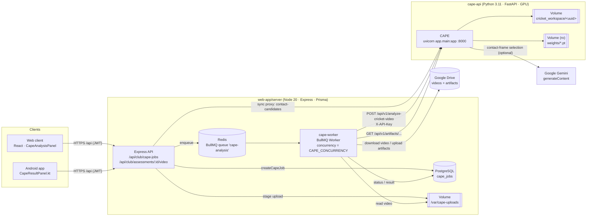

### Responsibilities split

| Concern | Node (web-app/server) | CAPE (cape-api) |
|---|---|---|
| Public API, JWT, roles, tenant isolation | Yes | No |
| Queue, retries, back-off, job status | BullMQ + `cape_jobs` | No |
| Video source (upload / Drive) | Stages to `CAPE_UPLOAD_DIR` | Receives multipart file |
| Inference (YOLO, MediaPipe, tracking) | No | Yes |
| Coaching rules, score | No | Yes (`coaching_rules.yaml`) |
| Artifact storage | Drive (long-term) | Session dir (TTL 15 min) |
| Gemini usage | Optional coaching summary (`CAPE_GEMINI_SUMMARY`) | Optional impact-frame selection only |

---

## 2. Technology stack

| Layer | Technology | Notes |
|---|---|---|
| Language | Python 3.11 | deadsnakes build in the CUDA image |
| Web framework | FastAPI 0.115, Starlette | OpenAPI/docs UI disabled (`docs_url=None`) |
| ASGI server | Uvicorn 0.32 (`uvicorn[standard]`) | `CAPE_WORKERS` processes, default 1 |
| Multipart | python-multipart 0.0.20 | Streamed to disk in 1 MB chunks |
| Validation / config | Pydantic v2.10, pydantic-settings 2.7 | Env prefix `CAPE_`, optional `.env` |
| Numerics | NumPy 1.26 | Homography, Kalman filter, geometry |
| Video / imaging | opencv-python-headless 4.10 | Decode, draw overlays, JPEG encode |
| Detection / segmentation / pose | Ultralytics 8.3 (YOLO11n, YOLO11n-pose, YOLO11n-seg) on PyTorch 2.5.1 (cu121) | Lazy-loaded, thread-locked, CUDA→CPU fallback |
| Fine pose | MediaPipe 0.10.18 Pose (heavy, `model_complexity=2`) | 33 landmarks on a cropped ROI |
| Rules | PyYAML 6 | `app/rules/coaching_rules.yaml` |
| AI assist | Google Gemini REST (`v1beta/models/{model}:generateContent`) via `urllib` | Impact-frame selection only |
| Tests | pytest + FastAPI `TestClient` | Fake detectors, synthetic frames, no GPU |
| Container | `nvidia/cuda:12.2.2-runtime-ubuntu22.04` (GPU) / `python:3.11-slim` (CPU) | Non-root UID 10001, HEALTHCHECK on `/health` |
| Training | Ultralytics training, Label Studio export conversion | [cape-api/training/](../cape-api/training/) |

---

## 3. Component view

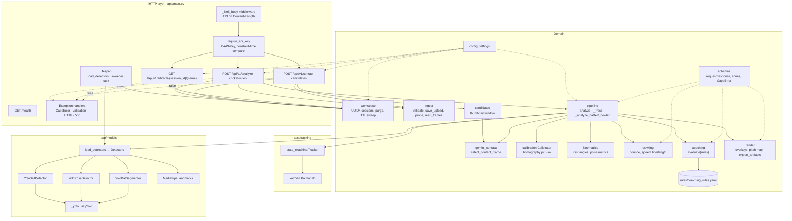

### 3.1 Module reference

| Module | Key symbols | Responsibility |
|---|---|---|
| [app/main.py](../cape-api/app/main.py) | `create_app`, `require_api_key`, `app_settings`, routes | FastAPI app, auth, body-size guard, error mapping, lifespan (model load + TTL sweeper) |
| [app/config.py](../cape-api/app/config.py) | `Settings`, `get_settings` | Env config (`CAPE_*`) |
| [app/schemas.py](../cape-api/app/schemas.py) | `AnalysisRequest`, `ManualFrames`, `AnalysisResponse`, `Coaching`, `Delivery`, `DownloadEndpoints`, `CapeError`, zone tables | Contracts, enums, pitch geometry constants |
| [app/workspace.py](../cape-api/app/workspace.py) | `create_session`, `session_path`, `purge_input`, `purge`, `sweep_expired` | UUID4 session dirs, path-traversal-safe |
| [app/ingest.py](../cape-api/app/ingest.py) | `validate_upload`, `save_upload`, `probe`, `read_frames` | Upload validation, chunked save, video probe, tolerant decoder |
| [app/pipeline.py](../cape-api/app/pipeline.py) | `analyze`, `_Pass`, `_analyze_batter`, `_analyze_bowler` | Single decode pass orchestration |
| [app/gemini_contact.py](../cape-api/app/gemini_contact.py) | `select_contact_frame`, `ContactSelection` | Two-stage Gemini impact-frame selection |
| [app/candidates.py](../cape-api/app/candidates.py) | `contact_candidates` | Thumbnails for manual frame tagging |
| [app/calibration.py](../cape-api/app/calibration.py) | `Calibrator` | 4-point planar homography, speed |
| [app/kinematics.py](../cape-api/app/kinematics.py) | `joint_angle`, `batter_angles`, `pose_metrics`, `head_travel_pct` | Biomechanics |
| [app/bowling.py](../cape-api/app/bowling.py) | `bounce_index`, `delivery_metrics`, `length_zone`, `line_zone` | Delivery analytics |
| [app/coaching.py](../cape-api/app/coaching.py) | `load_rules`, `applicable_checks`, `evaluate`, `describe_delivery` | Deterministic faults & score |
| [app/render.py](../cape-api/app/render.py) | `draw_*`, `draw_pitch_map`, `export_artifacts` | Overlays, crops, atomic JPEG writes |
| [app/tracking/state_machine.py](../cape-api/app/tracking/state_machine.py) | `Phase`, `Tracker` | Ball contact via velocity inversion |
| [app/tracking/kalman.py](../cape-api/app/tracking/kalman.py) | `Kalman2D` | Constant-velocity filter for post-contact gaps |
| [app/models/](../cape-api/app/models/) | `load_detectors`, `Detectors`, `Box`, `PoseResult`, `Landmarks` | ML adapters behind Protocols |

### 3.2 Model adapters (class view)

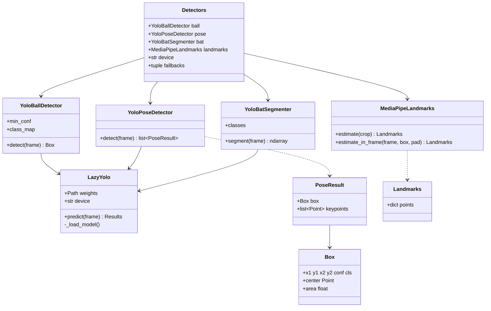

**Weights** (`CAPE_WEIGHTS_DIR`, mounted read-only):

| Role | Custom file | Fallback (logged, listed in `Detectors.fallbacks`) |
|---|---|---|
| Ball | `ball.pt` (classes `0 cricket_ball`, `1 blurred_ball`) | `yolo11n.pt`, COCO class 32 "sports ball", `min_conf` 0.15 |
| Pose (17 COCO keypoints) | `yolo11n-pose.pt` | — (required) |
| Bat segmentation | `bat-seg.pt` (class `0 cricket_bat`) | `yolo11n-seg.pt`, COCO class 34 "baseball bat" |
| Landmarks | MediaPipe Pose heavy (baked into image at build) | — |

`load_detectors` validates file presence at startup (raises `MissingWeightsError` → `app.state.detectors = None` → analyse returns `503 models_unavailable`). Ultralytics/MediaPipe are imported on first inference only. Each `LazyYolo` holds a lock (thread-safe `predict`) and on a CUDA/cuDNN/cuBLAS `RuntimeError` reloads itself on CPU.

---

## 4. HTTP API

All `/api/v1/*` routes require `X-API-Key` when `CAPE_API_KEY` is set (no-op in local dev when unset). Errors are always JSON:

```json
{ "status": "error", "error": "<code>", "message": "<text>", "details": [ ... ] }
```

### 4.1 `POST /api/v1/analyze-cricket-video`

`multipart/form-data`

| Field | Type | Required | Rules |
|---|---|---|---|
| `file` | video | Yes | ext ∈ `.mp4 .mov .m4v .avi .mkv`; MIME `video/*` or generic; ≤ `CAPE_MAX_UPLOAD_MB` (500); non-empty |
| `target` | `batter` \| `bowler` | Yes | |
| `handedness` | `right` \| `left` | Yes | Batter's handedness (also drives line side for bowling) |
| `calibration_points` | JSON `[[x,y]×4]` | Yes | Video pixels; finite, ≥ 0, distinct, no 3 collinear, inside frame. Order: batter-end left, batter-end right, bowler-end right, bowler-end left (as seen from bowler's end) |
| `shot_type` | enum | batter only | `front_foot_drive`, `back_foot_drive`, `forward_defence`, `backward_defence`, `pull`, `cut`, `sweep` |
| `bowler_type` | `pace` \| `spin` | bowler only | |
| `pitch_points_m` | JSON `[[x,y]×4]` | No | Defaults to the 3.05 m × 20.12 m pitch rectangle |
| `manual_frames` | JSON object | No (batter only) | `{pre_contact:[..], point_of_contact:[..≥1], post_contact:[..]}`, ≤ 20 each, 0-based decoded indices, strictly ordered pre < contact < post; a bare int is wrapped |

**200 response** (`AnalysisResponse`, abbreviated – batter):

```json
{
  "status": "success",
  "session_id": "3f0e…-uuid4",
  "metadata": { "resolution": "1920x1080", "framerate_fps": 59.94, "target": "batter",
                "selected_target": "batter", "handedness": "right", "shot_type": "front_foot_drive" },
  "analytics_payload": {
    "pre_contact":   { "milestone_frame": 112, "batter_joint_angles": {"front_elbow": 141.2},
                       "swing_frames": [], "bat_swing_arc_degrees": null, "bat_swing_speed_kmh": null,
                       "swing_frames_auto": false, "bat_swing_estimated": false },
    "point_of_contact": { "milestone_frame": 121, "selection_source": "gemini", "selection_confidence": 0.82,
                          "candidate_frames": [], "ball_velocity_kmh": 104.3, "bat_angle_degrees": 32.5,
                          "head_front_knee_offset_pct": 4.1, "stride_m": 0.92, "ball_line": "off_stump_channel",
                          "batter_joint_angles": {"front_knee": 128.0}, "batter_3d_landmarks": {"nose": [812.1, 301.4, -40.2]} },
    "post_contact":  { "milestone_frame": 133, "exit_velocity_kmh": 71.0, "launch_angle_degrees": 8.0,
                       "follow_through_frames": [], "follow_through_arc_degrees": null }
  },
  "delivery": null,
  "coaching": {
    "score": 80, "verdict": "…",
    "faults": [{ "code": "head_behind_front_knee", "milestone": "point_of_contact", "metric": "head_front_knee_offset_pct",
                 "value": -12.3, "expected": [0, 25], "severity": "medium",
                 "message": "…", "recommendation": "…", "drill": "…" }],
    "strengths": ["…"], "unavailable": ["bat_ahead_of_pad_cm"], "summary": null
  },
  "download_endpoints": {
    "pre_contact_snapshot":  "/api/v1/artifacts/<sid>/1_pre_contact.jpg",
    "impact_snapshot":       "/api/v1/artifacts/<sid>/2_point_of_contact.jpg",
    "post_contact_snapshot": "/api/v1/artifacts/<sid>/3_post_contact.jpg",
    "all_zip":               "/api/v1/artifacts/<sid>/all.zip"
  }
}
```

For `target=bowler`: `analytics_payload.release` (`milestone_frame`, `bowler_joint_angles`, `release_height_m`), `delivery` (`speed_kmh`, `speed_tolerance_kmh`, `pitching_point_m`, `length_m`, `length_zone`, `line_zone`, `is_good_ball`) and endpoints `release_snapshot`, `pitching_point_snapshot`, `pitch_map`. Endpoints for artifacts that were not written are `null`.

### 4.2 `POST /api/v1/contact-candidates`

`multipart/form-data`: `file` (required), `center_frame` (0…1 000 000, optional), `before` (0–40, default 15), `after` (0–40, default 10).

Returns `ContactCandidatesResponse`:

```json
{ "framerate_fps": 30.0, "frame_count": 240, "suggested_frame": 131,
  "suggestion_source": "gemini", "suggestion_note": null,
  "frames": [{ "index": 116, "time_s": 3.867, "image_base64": "<480px JPEG>" }] }
```

With `center_frame`, Gemini is skipped (used for panning). The session directory is always purged on return.

### 4.3 `GET /api/v1/artifacts/{session_id}/{name}`

`name` ∈ `{1_pre_contact.jpg, 2_point_of_contact.jpg, 3_post_contact.jpg, 1_release.jpg, 2_pitching_point.jpg, 3_pitch_map.jpg, all.zip}`. `session_id` must be a canonical UUID4. ZIP is built lazily (stored, atomic rename) on first request. Returned as `Content-Disposition: attachment`. Unknown / expired → `404 not_found`.

### 4.4 `GET /health`

`{"status":"ok"}` – unauthenticated; filtered out of the access log.

### 4.5 Error catalogue

| HTTP | `error` | Raised by |
|---|---|---|
| 401 | `unauthorized` | `require_api_key` |
| 404 | `not_found` | artifact route |
| 413 | `file_too_large` | body middleware / `save_upload` |
| 415 | `unsupported_media_type` | `validate_upload` |
| 422 | `validation_error` | Pydantic / form parsing (with `details`) |
| 422 | `empty_file` | `save_upload` |
| 422 | `unreadable_video` | `probe`, `analyze`, `candidates` |
| 422 | `calibration_out_of_frame` | `_check_points_in_frame` |
| 422 | `calibration_invalid` | `Calibrator` (degenerate / collinear) |
| 422 | `manual_frames_out_of_range` | `analyze` |
| 422 | `no_contact_detected` | `_analyze_batter` |
| 422 | `no_contact_point_detected` | `_analyze_batter` (auto mode) |
| 422 | `no_pitching_point_detected` | `_analyze_bowler` |
| 503 | `models_unavailable` | `analyze` when weights missing |
| 500 | `internal_error` | unhandled exception (logged, no stack trace returned) |

Node maps codes to user text via `friendlyCapeError(code)`; 5xx and network errors are `retryable` in the worker.

---

## 5. End-to-end flow

### 5.1 Asynchronous analysis (production path)

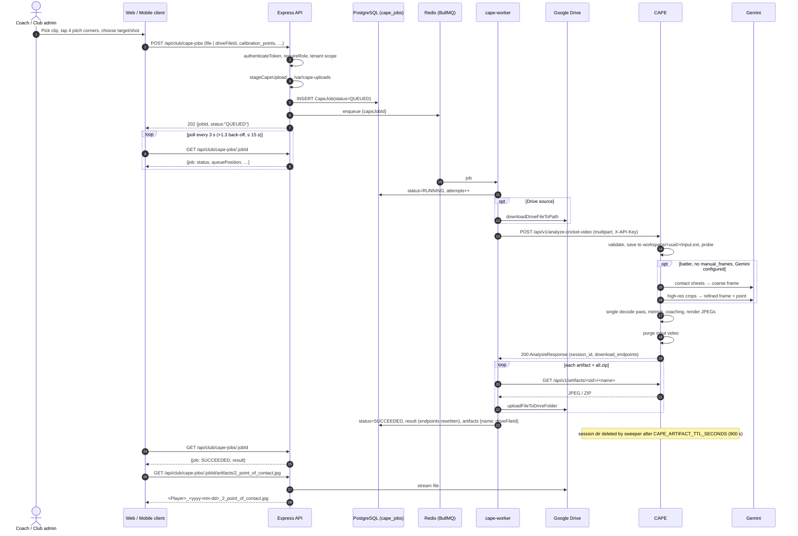

On a `CapeError` the worker sets `status=QUEUED` with `error=<code>` when retryable and attempts remain, otherwise `FAILED`.

### 5.2 Manual frame selection (poor-quality clips)

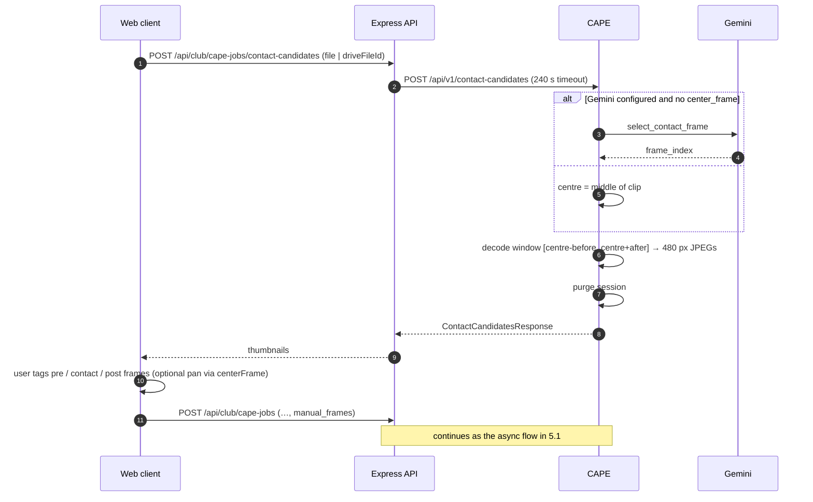

### 5.3 Inside `POST /analyze-cricket-video`

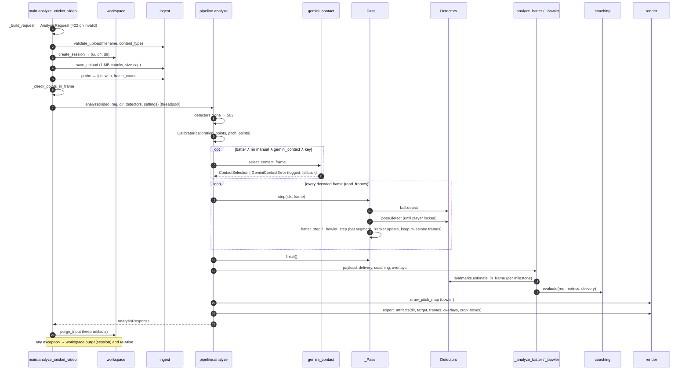

---

## 6. Pipeline low-level design

### 6.1 Single decode pass – `_Pass`

The video is decoded **once** with `ingest.read_frames` (tolerates up to 8 consecutive undecodable packets; frame indices count only yielded frames, so manual indices, thumbnails and milestones agree). State held per pass:

| Field | Purpose |
|---|---|
| `buffer: deque` | Ring buffer of the last `0.5·fps + 16` frames for look-back (`_frame_at`) |
| `frames: {milestone: (idx, img)}` | Copies of selected milestone frames |
| `boxes: {milestone: Box}` | Player box per milestone (for landmarks and crop) |
| `locked: Box` | Target player lock |
| `tracker: Tracker` | Ball phase machine (batter) |
| `ball_track` / `track` | Ball centres (batter / bowler) |
| `best_bat_contact` | Best (ball↔bat polygon + wrist) score in detector mode |
| `best_manual_contact` | Best `(tier, score)` contact among manual candidates |
| `swing_samples` | `{frame: (hands, bat_tip)}` in manual mode |
| `crease_px` | Batter stumps (0,0) or bowling crease (0, 20.12 − 1.22) projected to pixels |

**Player lock**
- Batter: person whose box-foot is nearest the batter-stumps pixel.
- Bowler: among persons that moved > 0.5 % of frame width since the previous frame, the one nearest the bowling crease; after 10 tries any person is accepted.

### 6.2 Batter contact-frame selection

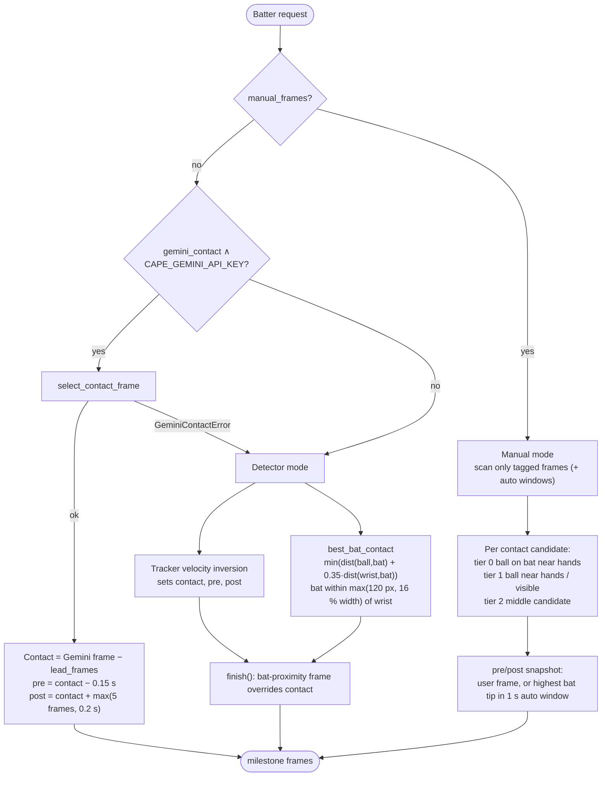

**Gemini selection (`gemini_contact.select_contact_frame`)**
1. **Coarse**: sample ≤ 48 frames evenly, build 4×4 contact sheets (320 px tiles, labelled `FRAME n | t s`), ask for the impact frame as JSON (`temperature 0`, `responseMimeType: application/json`).
2. **Fine**: take frames from `coarse − max(stride, 0.75 s)` to `coarse + max(stride, 0.2 s)`, crop around the largest pose box (pad 40 % × 20 %), encode at 768 px, ask again for the *earliest* overlap frame and a normalised contact point.
3. Map the point back to full-frame coordinates; subtract `CAPE_GEMINI_CONTACT_LEAD_FRAMES` (default 1).
4. Retries: HTTP 429/5xx up to 4 attempts (honours `Retry-After`, ≤ 10 s); network errors 2 attempts. Out-of-set frame → snapped to nearest allowed.

Gemini **only selects a frame / point**; every measurement is computed deterministically by CAPE.

**Manual mode details**
- Empty `pre_contact` / `post_contact` ⇒ auto window of `AUTO_WINDOW_S` = 1 s before first / after last contact, thinned to ≤ 30 frames; the snapshot is the frame with the highest bat tip (top of backswing / end of follow-through).
- Bat tip = centroid of polygon vertices ≥ 90 % of max distance from hands. If no bat mask: tip = hands + 3 × mean forearm (elbow→wrist) direction, flagged `*_estimated`.
- If no ball is found full-frame, a padded crop around the player is re-scanned (`_detect_ball_near_player`).

### 6.3 Ball tracker state machine

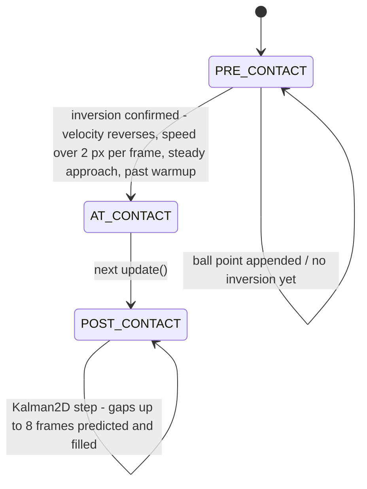

- `contact_frame` is the inversion **vertex** frame; `update` returns `AT_CONTACT` once on the confirming frame.
- `Kalman2D`: state `[x, y, vx, vy]`, constant velocity, discrete white-noise acceleration (`q = 1`), `R = 4·I`.

### 6.4 Bowler flow

1. `release` = frame of the first ball detection (player box = person nearest the ball).
2. Each detection appended to `track`; `bounce_index(track, settled=True)` finds the first down→up turn of the 3-point-smoothed image-y velocity, ignoring turns that later points could still change.
3. On a settled bounce the pass stops early (`done = True`).
4. `delivery_metrics`: pitching point → metres via homography; speed = ground distance release→pitch / Δt; `length_zone` (by bowler type) and `line_zone` (offset from middle stump, + = off side); `is_good_ball` = good length ∧ line ∈ {stumps, off-stump channel}.
5. Bowling arm = higher wrist at release; release height = (ankle − highest wrist) / (ankle − nose) × 1.68 m (approximate).

| Length (m from batter stumps) | Pace | Spin |
|---|---|---|
| yorker | 0–2 | 0–1 |
| full | 2–5 | 1–3 |
| good_length | 5–8 | 3–5 |
| short_of_a_length | 8–10 | 5–6 |
| short | ≥ 10 | ≥ 6 |

| Line (offset, m, + = off) | Range |
|---|---|
| down_leg | < −0.15 |
| stumps | −0.15 … 0.15 |
| off_stump_channel | 0.15 … 0.45 |
| wide_of_off | ≥ 0.45 |

### 6.5 Landmarks per milestone

`_Pass.landmarks(key)`:
1. MediaPipe on the player crop (`pad 0.15`), landmarks remapped to full-frame pixels, `z` scaled by crop width (isotropic), visibility ≥ 0.5 (feet ≥ 0.2).
2. If knees/ankles are missing: retry with `pad 0.3` for feet, then fall back to the YOLO-pose 17-point skeleton (`z = 0`) supplemented with MediaPipe heel/toe points.

### 6.6 Metrics computed

| Metric | Source | Definition |
|---|---|---|
| `front_/back_` `elbow`, `knee`, `shoulder` | `kinematics.batter_angles` | 3D angle at vertex (shoulder-elbow-wrist, hip-knee-ankle, elbow-shoulder-hip). Front = left for right-hander |
| `head_front_knee_offset_pct` | `pose_metrics` | (nose.x − front_knee.x)·facing / torso × 100 |
| `hands_height_pct`, `front_elbow_height_pct` | `pose_metrics` | height above front shoulder as % of torso |
| `head_travel_pct`, `post_contact.head_travel_pct` | `head_travel_pct` | nose displacement / mean torso × 100 |
| `bat_angle_deg` | `bat_angle_deg` (PCA of bat mask) or hands→contact | angle from vertical, handle→toe |
| `stride_m` | homography | front-to-back ankle distance on the ground plane |
| `bat_ahead_of_pad_cm` | bat mask + front knee | lead bat point ahead of front knee |
| `front_foot_to_contact_angle_deg`, `front_toe_contact_distance_cm` | `front_foot_metrics` | front foot direction vs. impact |
| `chin_front_toe_offset_pct`, `front_shoulder_target_angle_deg`, `back_foot_crease_angle_deg` | `batting_alignment_metrics` | alignment at impact (nose as chin proxy) |
| `pre_contact.bat_swing_arc_deg`, `post_contact.follow_through_arc_deg` | `swing_arc_deg` (manual) | unwrapped image-plane bat rotation, ≤ 360° |
| `pre_contact.bat_swing_speed_kmh` | `bat_swing_speed_kmh` (manual) | tip path over last 0.2 s (0.4 s fallback); scale = 0.8 m / longest hands→tip; ≤ 250 km/h |
| `ball_velocity_kmh`, `exit_velocity_kmh` | `_speed` | homography distance / time over ≤ 5 points |
| momentum / kinetic energy | ball mass 0.156 kg | `m·v`, `½·m·v²` |
| `launch_angle_degrees` | post-contact track | `atan2(−dy, |dx|)` in image plane |
| `ball_line` | contact x in metres | `line_zone(line_offset_m(x))` |
| `release_height_m` | bowler | body-ratio estimate |

> Speeds use a ground-plane homography; a ball in flight is above the plane, so values are approximations, not radar-grade.

### 6.7 Calibration

`Calibrator` solves the 8×8 DLT system in float64 (same as `cv2.getPerspectiveTransform`), rejects degenerate quads (any 3 collinear) or a singular matrix, and exposes `to_metres`, `to_pixels`, `speed_kmh`. Pitch frame: origin = batter's middle stump at ground level, +y towards bowler, +x right as seen from the bowler's end.

### 6.8 Coaching engine

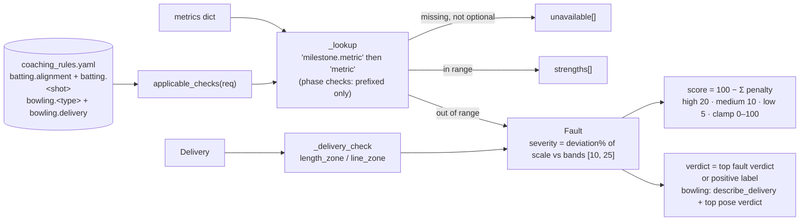

Rules are loaded once (`lru_cache`) and validated (`code`, `milestone`, `metric`, `min`/`max`, message/recommendation per side). Same inputs always produce the same output.

### 6.9 Rendering & artifacts

- Overlays are `functools.partial` layers applied bottom-up; every `draw_*` returns a copy (BGR colours).
- When a milestone has a player box, the frame is cropped (`1.2×` horizontal, `0.8×` vertical padding) and all point arguments of known layers are translated (`_translate_overlay`).
- Layers per batter milestone: ball trail, skeleton + head/knee plumb + head-to-ball sight line, angle arcs coloured `ok`/`warn`/`fault`, batting guides (incoming/outgoing ball, back-foot crease, shoulder target), swing / follow-through strobe (manual), metrics panel (≤ 8 lines).
- Bowler: release (skeleton, angles, speed panel), pitching point (trail, impact marker, length/line panel), 400×900 pitch map with zone bands.
- JPEGs (quality 90) are written atomically (`tmp` + `os.replace`).

| Target | Artifacts |
|---|---|
| batter | `1_pre_contact.jpg`, `2_point_of_contact.jpg`, `3_post_contact.jpg`, `all.zip` |
| bowler | `1_release.jpg`, `2_pitching_point.jpg`, `3_pitch_map.jpg`, `all.zip` |

---

## 7. Session workspace lifecycle

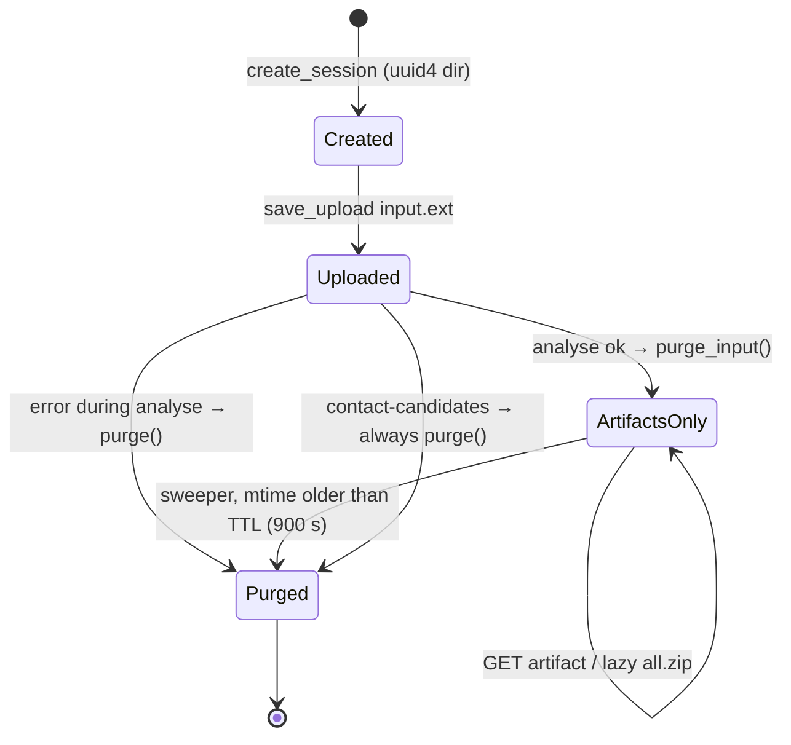

- Session IDs are server-generated UUID4; `session_path` re-parses the ID and checks the resolved parent equals the workspace root (no path traversal).
- The sweeper runs at startup and every `CAPE_SWEEP_INTERVAL_SECONDS` (60) in a background task; non-UUID entries and symlinks are ignored.
- The caller (Node worker) must download artifacts within the TTL.

---

## 8. Configuration

| Env var | Default | Purpose |
|---|---|---|
| `CAPE_API_KEY` | unset | Shared secret for `X-API-Key`; **must** be set outside local dev |
| `CAPE_DEVICE` | `cuda` | `cuda` or `cpu` (auto-fallback to CPU if CUDA unavailable) |
| `CAPE_WEIGHTS_DIR` | `weights` (`/app/weights` in image) | Model weights directory |
| `CAPE_WORKSPACE_DIR` | `cricket_workspace` | Session dirs |
| `CAPE_MAX_UPLOAD_MB` | 500 | Upload cap (body + 1 MB framing) |
| `CAPE_ARTIFACT_TTL_SECONDS` | 900 | Artifact retention |
| `CAPE_SWEEP_INTERVAL_SECONDS` | 60 | Sweeper period |
| `CAPE_GEMINI_API_KEY` | unset | Enables Gemini contact selection |
| `CAPE_GEMINI_MODEL` | `gemini-flash-latest` | Model name |
| `CAPE_GEMINI_CONTACT` | `true` | Feature toggle |
| `CAPE_GEMINI_TIMEOUT_SECONDS` | 90 | Per-request timeout |
| `CAPE_GEMINI_CONTACT_LEAD_FRAMES` | 1 (0–5) | Frames subtracted from Gemini's choice |
| `CAPE_WORKERS` | 1 | Uvicorn processes (each loads its own models → GPU memory per worker) |

Node-side counterparts: `CAPE_API_URL` (`http://cape-api:8000`), `CAPE_API_KEY`, `CAPE_CONCURRENCY` (= GPU slots), `CAPE_TIMEOUT_MS` (600 000), `CAPE_UPLOAD_DIR`, `CAPE_GEMINI_SUMMARY`.

---

## 9. Deployment

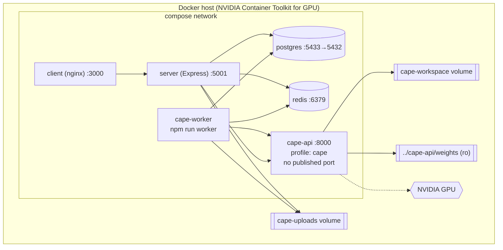

| File | Use |
|---|---|
| [cape-api/Dockerfile](../cape-api/Dockerfile) | Two-stage CUDA 12.2 build, PyTorch 2.5.1 cu121 (driver ≥ 530), headless OpenCV, MediaPipe heavy model pre-fetched, non-root `cape` (UID 10001), HEALTHCHECK |
| [cape-api/Dockerfile.cpu](../cape-api/Dockerfile.cpu) | `python:3.11-slim`, CPU torch |
| [cape-api/docker-compose.yml](../cape-api/docker-compose.yml) | Standalone GPU run, publishes 8000 (dev/testing) |
| [cape-api/docker-compose.cpu.yml](../cape-api/docker-compose.cpu.yml) | CPU override |
| [web-app/docker-compose.yml](../web-app/docker-compose.yml) | Full stack; `cape-api` + `cape-worker` under profile `cape`, CAPE not published |
| [web-app/docker-compose.cape-cpu.yml](../web-app/docker-compose.cape-cpu.yml) | CPU override for the full stack |

**Scaling:** throughput = `CAPE_CONCURRENCY` (Node worker) × per-request latency. Each Uvicorn worker loads its own models; increase `CAPE_WORKERS` only if GPU memory allows. Requests run in the threadpool; YOLO calls are serialised per model by a lock.

---

## 10. How to use

### 10.1 Run locally (Python)

```powershell
cd cape-api
python -m venv .venv
.\.venv\Scripts\Activate.ps1
pip install -r requirements.txt          # torch: install a matching build first for GPU
# place yolo11n-pose.pt (+ ball.pt / bat-seg.pt or yolo11n.pt / yolo11n-seg.pt) in .\weights
$env:CAPE_DEVICE = "cpu"
$env:CAPE_API_KEY = "dev-key"
uvicorn app.main:app --host 127.0.0.1 --port 8000
```

### 10.2 Run in Docker

```powershell
cd cape-api
docker compose up --build                                          # GPU
docker compose -f docker-compose.yml -f docker-compose.cpu.yml up --build   # CPU
```

Full stack: `cd web-app; sh deploy.sh` (starts the `cape` profile).

### 10.3 Call the API directly

```powershell
curl.exe -X POST http://127.0.0.1:8000/api/v1/analyze-cricket-video `
  -H "X-API-Key: dev-key" `
  -F "file=@clip.mp4;type=video/mp4" `
  -F "target=batter" -F "handedness=right" -F "shot_type=front_foot_drive" `
  -F "calibration_points=[[612,880],[1310,872],[1010,402],[905,404]]"

curl.exe -H "X-API-Key: dev-key" -OJ `
  http://127.0.0.1:8000/api/v1/artifacts/<session_id>/all.zip
```

Bowler: replace `shot_type` with `-F "bowler_type=pace"` and `-F "target=bowler"`.
Manual frames: `-F 'manual_frames={"pre_contact":[],"point_of_contact":[120,121,122],"post_contact":[]}'`.

### 10.4 Capturing a good clip

- Fixed camera, behind or side-on, full batter (or bowler + pitch) in frame, ≥ 50 fps preferred.
- All 4 pitch corners (or chosen calibration points) visible and tapped in the documented order.
- Short clips (one delivery) decode faster and reduce false contacts.

### 10.5 Tests

```powershell
cd cape-api
.\.venv\Scripts\python.exe -m pytest -q                       # all
.\.venv\Scripts\python.exe -m pytest tests/test_pipeline.py -q  # one module
```

Tests use fake detectors implementing the Protocols and synthetic NumPy frames; no GPU, weights or real video.

### 10.6 Training custom models

| Step | Tool |
|---|---|
| Extract frames (sparse + dense around contact) | `training/extract_frames.py` → `images/*.jpg`, `manifest.csv` |
| Label in Label Studio, convert | `training/labelstudio_to_yolo.py` |
| Group-aware split (one video → one split) | `training/split_dataset.py` (0.8/0.1/0.1) |
| Train ball detector | `training/train_ball.py` → `weights/ball.pt` |
| Train bat segmenter | `training/train_bat.py` (validates seg labels) → `weights/bat-seg.pt` |

See [cape-api/training/ANNOTATION.md](../cape-api/training/ANNOTATION.md).

---

## 11. Security design

| Control | Implementation |
|---|---|
| Network exposure | CAPE has no published port in the full stack; only Node reaches it |
| Authentication | `X-API-Key` checked with `secrets.compare_digest` on every `/api/v1` route |
| Input validation | Extension + MIME allow-list, size cap (header + streamed), Pydantic enums, finite/distinct/in-frame calibration points, `extra="forbid"` |
| Path safety | Server-generated UUID4 session IDs, resolved-parent check, artifact names from a fixed allow-list |
| Error hygiene | Uniform JSON errors; unhandled exceptions logged server-side, generic `internal_error` returned |
| Data minimisation | Input video deleted right after analysis; artifacts deleted after TTL; no PII stored |
| Container | Non-root user, weights mounted read-only, models baked at build (no runtime downloads) |

**Known risk:** `gemini_contact._request` passes the API key as a `?key=` query parameter. Query strings can appear in proxy or error logs (e.g. inside an `HTTPError` message that is logged). Prefer the `x-goog-api-key` request header.

---

## 12. Limitations & assumptions

- Speeds and distances assume a planar ground homography; ball height and lens distortion are not modelled.
- Bat swing speed assumes a 0.8 m hands-to-toe bat; release height assumes a 1.68 m nose height.
- Single-camera, 2D image-plane arcs and launch angle; MediaPipe `z` is relative depth only.
- COCO fallback weights are much weaker on cricket footage; custom `ball.pt` / `bat-seg.pt` are strongly recommended.
- Coaching thresholds in `coaching_rules.yaml` are heuristics pending coach validation.
- Artifacts are only available for `CAPE_ARTIFACT_TTL_SECONDS`; the caller must persist them.
