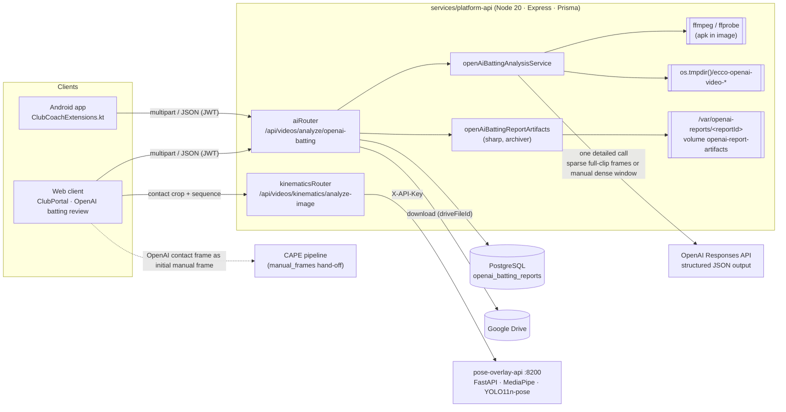
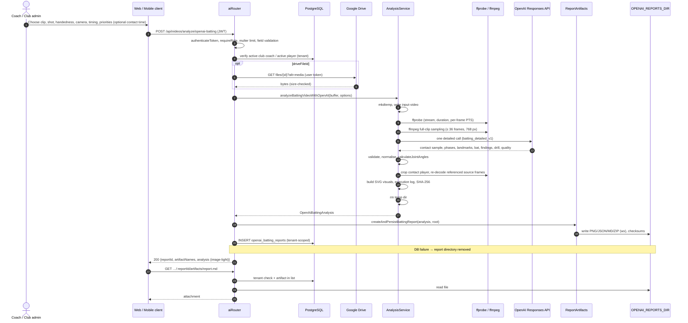
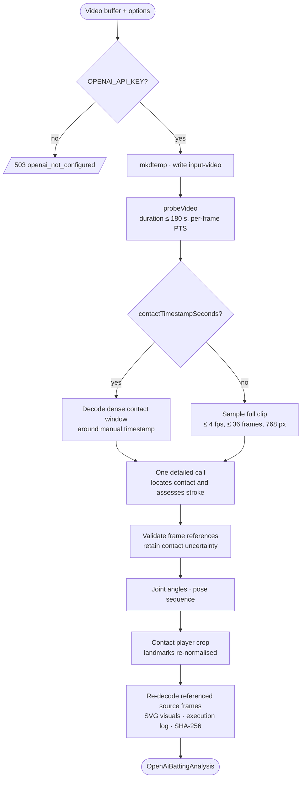
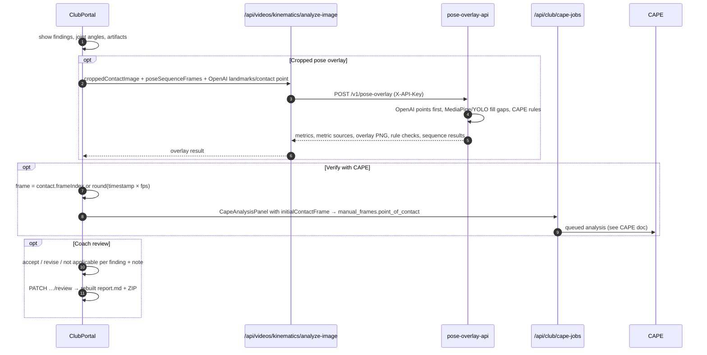
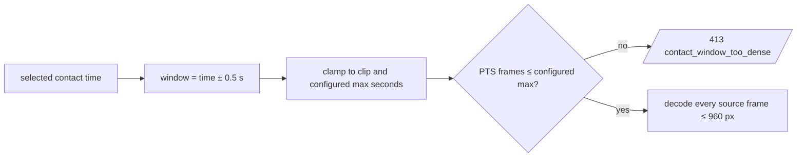
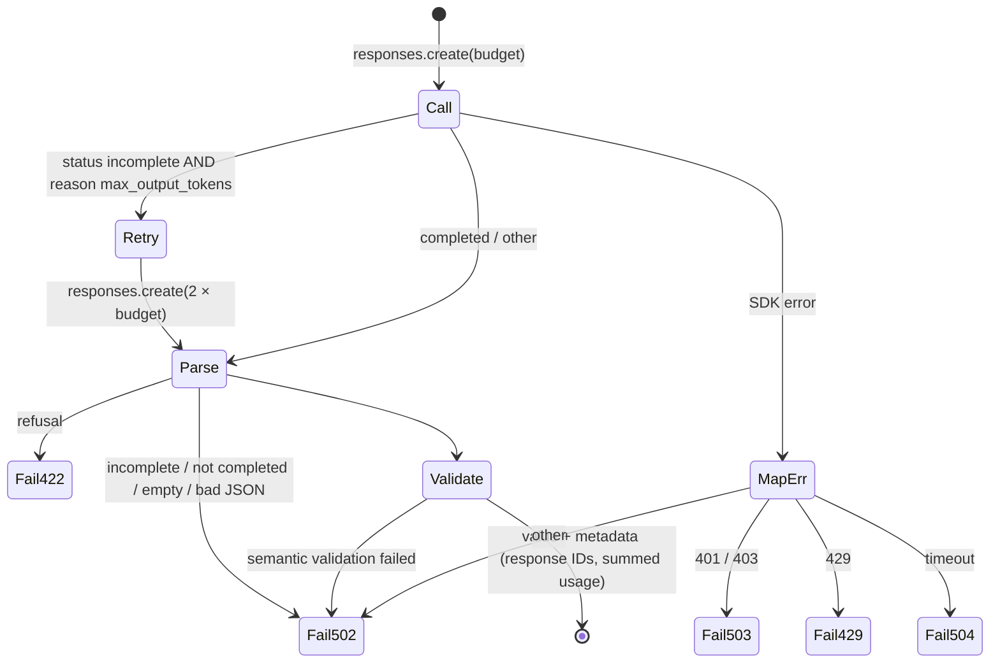
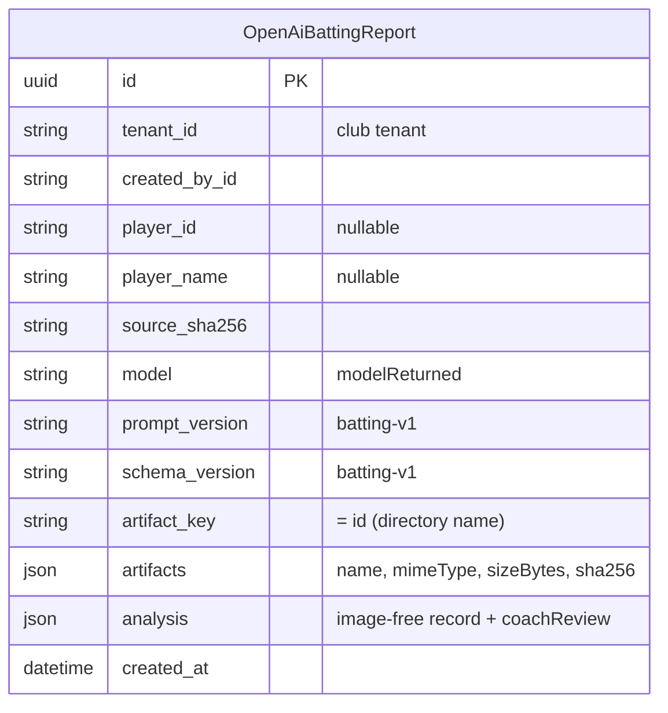
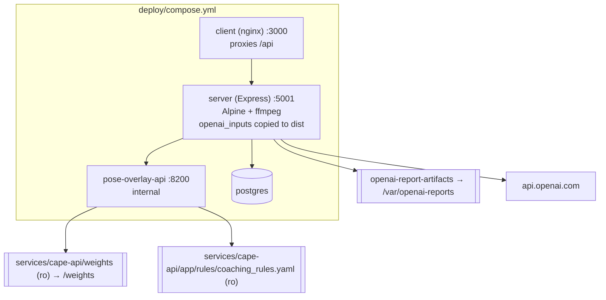

# OpenAI Batting Analysis API – Architecture & Low-Level Design

The **OpenAI batting analysis** feature is a synchronous, coach-facing review pipeline inside the Node/Express server. It turns one batting clip into:

- a one-request full-clip batting review (likely contact, stroke phases, landmarks, bat shaft, findings, strengths and drill),
- application-calculated **2D projected** joint angles,
- a persisted, checksummed report bundle (PNG review images, JSON, Markdown, ZIP),
- an optional coach review layer and hand-offs to the **pose-overlay API** and **CAPE**.

OpenAI performs **visual interpretation only**. Decoding, frame mapping, angle maths, rendering, validation and persistence are done by the application.

Primary sources:

| Concern | File |
|---|---|
| HTTP routes | [services/platform-api/src/routes/ai.ts](../services/platform-api/src/routes/ai.ts) |
| Analysis pipeline | [services/platform-api/src/services/openAiBattingAnalysisService.ts](../services/platform-api/src/services/openAiBattingAnalysisService.ts) |
| Report artifacts & coach review | [services/platform-api/src/services/openAiBattingReportArtifacts.ts](../services/platform-api/src/services/openAiBattingReportArtifacts.ts) |
| In-response SVG visuals | [services/platform-api/src/services/openAiBattingVisuals.ts](../services/platform-api/src/services/openAiBattingVisuals.ts) |
| Versioned prompts & schemas | [services/platform-api/src/services/openai_inputs/](../services/platform-api/src/services/openai_inputs/) |
| Persistence model | [services/platform-api/prisma/schema.prisma](../services/platform-api/prisma/schema.prisma) (`OpenAiBattingReport`) |
| Cropped pose overlay proxy | [services/platform-api/src/routes/kinematics.ts](../services/platform-api/src/routes/kinematics.ts) → [services/pose-overlay-api/app.py](../services/pose-overlay-api/app.py) |
| Web client | [apps/web/src/components/club/ClubPortal.tsx](../apps/web/src/components/club/ClubPortal.tsx), [CroppedPoseOverlayPanel.tsx](../apps/web/src/components/club/CroppedPoseOverlayPanel.tsx), [services/api.ts](../apps/web/src/services/api.ts) |
| Mobile client | [ClubCoachExtensions.kt](../apps/mobile/club/android/app/src/main/java/com/ecricketcoach/mobile/presentation/club/ClubCoachExtensions.kt), [CoachApi.kt](../apps/mobile/club/android/app/src/main/java/com/ecricketcoach/mobile/data/api/CoachApi.kt) |
| Feature notes | [docs/openai-batting-analysis.md](openai-batting-analysis.md) |

---

## 1. Position in the system

Unlike CAPE (queued, GPU, deterministic), the OpenAI pipeline runs **in-process in the Express server during the HTTP request** and returns the full result in the response.



### Responsibilities split

| Concern | Application (Node) | OpenAI model |
|---|---|---|
| Auth, roles, tenant scope | Yes | — |
| Video decode, PTS mapping, frame extraction | ffprobe / ffmpeg | — |
| Stroke localisation, phase labels, contact sample | Validates frame references | Proposes in one detailed response |
| Contact status / frame / point | Validates frame belongs to supplied samples | Proposes |
| Body & bat landmarks (normalised) | Validates ranges, remaps to crops | Estimates |
| Joint angles | **Calculates** from pixel-scaled landmarks | Must return `null` / pending |
| Findings, strengths, drill text | Schema + semantic validation | Generates |
| Kinetics | `not_measured` by visual interpretation; when requested, Node calls CAPE with the full clip to obtain CAPE-derived video estimates | No physical measurements |
| Rendering, checksums, ZIP, persistence | Yes | — |

---

## 2. Technology stack

| Layer | Technology | Notes |
|---|---|---|
| Runtime | Node.js 20, TypeScript, Express 4 | Same server process as the rest of the API |
| Upload | multer `memoryStorage` | Per-route limit `OPENAI_MAX_VIDEO_SIZE_MB` (default 500 MB) |
| AI SDK | `openai` ^7.36 — `client.responses.create` | One `batting_detailed_v1` request, strict JSON schema, default low reasoning, SDK retries **disabled** (`maxRetries: 0`) |
| Model | `OPENAI_VIDEO_ANALYSIS_MODEL` (default `gpt-6.1-sol`) | No silent substitution; requested vs returned model logged |
| Video tooling | `ffprobe` (per-frame `best_effort_timestamp_time`), `ffmpeg` (sample, select, crop) | Invoked with `execFile` (no shell) |
| Imaging | `sharp` (SVG overlay compositing, PNG montages) | |
| Archive | `archiver` `ZipArchive({ store: true })` | |
| Persistence | Prisma + PostgreSQL (`openai_batting_reports`), filesystem volume | |
| Hashing | Node `crypto` SHA-256 | Source video and every output artifact |
| Pose service | Python FastAPI, MediaPipe Pose, Ultralytics YOLO11n-pose, OpenCV | Separate container `pose-overlay-api` |
| Tests | `tsx --test` (node:test) | `openAiBattingAnalysisService.test.ts`, `openAiBattingReportArtifacts.test.ts`, `openAiBattingVisuals.test.ts` |

---

## 3. Component view

```mermaid
flowchart TB
    subgraph Routes["routes/ai.ts"]
        P1["POST /analyze/openai-batting"]
        G1["GET /analyze/openai-batting/:reportId/review"]
        P2["PATCH /analyze/openai-batting/:reportId/review"]
        G2["GET /analyze/openai-batting/:reportId/artifacts/:name"]
        MW["authenticateToken · requireRole CLUB_ADMIN/COACH<br/>multer (size-limited)"]
    end

    subgraph Service["openAiBattingAnalysisService.ts"]
        AN["analyzeBattingVideoWithOpenAI"]
        PR["probeVideo (ffprobe)"]
        SF["sampleFrames (local full-clip samples)"]
        EW["extractEverySourceFrameInWindow (manual timestamp)"]
        EO["extractOriginalSourceFrames (report-res)"]
        CR["createContactPlayerCrop"]
        RV["requestVisionJson&lt;T&gt;"]
        VAL["isDetailed<br/>normalizeDetailedEvidenceFrames"]
        JA["calculateJointAngles · calculateProjectedAngle"]
        WIN["selectDenseContactWindow"]
        AS["loadPromptAsset / loadSchemaAsset<br/>renderPromptTemplate"]
    end

    subgraph Visuals["openAiBattingVisuals.ts"]
        SVG["makeMovementSequenceSvg<br/>makeJointAlignmentSvg"]
    end

    subgraph Artifacts["openAiBattingReportArtifacts.ts"]
        CP["createAndPersistBattingReport"]
        RO["reviewOverlay · renderAnnotatedFrame"]
        MO["createPngMontage"]
        MD["markdownReport"]
        ZP["archiveBuffers"]
        CRV["persistBattingCoachReview"]
        TP["toPersistableAnalysis"]
        NM["isBattingReportArtifactName"]
    end

    ASSETS[("openai_inputs/<br/>shared-instructions.v1.md<br/>detailed.v1.md · detailed.schema.v1.json")]
    DB[("openai_batting_reports")]
    FS[("OPENAI_REPORTS_DIR")]
    OAI["OpenAI Responses API"]

    MW --> P1 & G1 & P2 & G2
    P1 --> AN
    AN --> PR & SF & WIN & EW & RV & JA & CR & EO & SVG
    RV --> OAI
    RV --> VAL
    AN --> AS
    AS --> ASSETS
    P1 --> CP
    CP --> RO & MO & MD & ZP & TP
    CP --> FS
    P1 --> DB
    P2 --> CRV
    CRV --> FS
    P2 --> DB
    G1 --> DB
    G2 --> NM
    G2 --> DB & FS
```



### 3.1 Key functions

| Function | Responsibility |
|---|---|
| `analyzeBattingVideoWithOpenAI(buffer, options)` | Orchestrates the whole pipeline in a temp dir; always deletes it in `finally` |
| `probeVideo` | ffprobe stream/format + per-frame PTS list; rejects bad metadata and `duration > OPENAI_MAX_VIDEO_DURATION_SECONDS` |
| `sampleFrames` | Full-clip sample JPEGs at `min(OPENAI_OVERVIEW_FPS, (maxFrames−1)/duration)` fps, longest side 768 px; each mapped to the nearest source PTS frame |
| `selectDenseContactWindow` | Window = anchor ± `OPENAI_CONTACT_CONTEXT_SECONDS`, widened to the model's proposed window if it is ≤ `OPENAI_MAX_CONTACT_WINDOW_SECONDS`, else clamped and centred |
| `extractEverySourceFrameInWindow` | Decodes **every** source PTS frame in the window (≤ 960 px); fails if count > `OPENAI_MAX_CONTACT_WINDOW_FRAMES` or decoded count ≠ expected |
| `combineContactAndPhaseFrames` | Dense frames + overview phase frames (low detail); dense frames within ±0.1 s of the anchor use `detail: high` |
| `requestVisionJson` | One Responses call with strict JSON schema; one retry with doubled `max_output_tokens` on `incomplete/max_output_tokens`; semantic validator; error mapping |
| `extractStructuredOutput` | Checks `status`, refusal, `output_text`, usage |
| `calculateJointAngles` | 8 triplets × each landmark frame → interior image-plane angle in pixel space |
| `calculateBatAngle` / `calculateContactBatAngle` | Handle→toe direction from straight down (CAPE convention) per bat frame; at contact falls back to wrists→contact point |
| `createContactPlayerCrop` | Crops the contact frame to the player box (+16 % x, +10 % y), scales to ≤ 960 px |
| `normalizeLandmarksInCrop` | Re-normalises full-frame landmarks into crop coordinates (drops out-of-crop points) |
| `extractOriginalSourceFrames` | Re-decodes referenced source frames (`select=eq(n,…)`) at original resolution for report images |
| `createAndPersistBattingReport` | Renders PNGs, JSON, Markdown, execution log, ZIP; writes each with `flag: 'wx'`; rolls back the directory on failure |
| `persistBattingCoachReview` | Rewrites `analysis.json`, appends to `report.md`, rebuilds ZIP via temp files + `rename` |
| `safeOpenAiErrorDiagnostics` | Redacts image data URLs, `sk-…` keys and bearer tokens from logged errors |

---

## 4. HTTP API

Base path: `/api/videos` (mounted in [services/platform-api/src/index.ts](../services/platform-api/src/index.ts)). All routes require a JWT (`authenticateToken`) and role `CLUB_ADMIN` or `COACH`. Errors are JSON `{ "error": "<code>", "message": "<text>" }`.

### 4.1 `POST /api/videos/analyze/openai-batting`

`multipart/form-data` (file) **or** JSON / form with `driveFileId`. Body fields accept camelCase or snake_case aliases.

| Field | Type | Default | Rules |
|---|---|---|---|
| `file` | video | — | `video/*` MIME; ≤ `OPENAI_MAX_VIDEO_SIZE_MB`. Exactly one of `file` / `driveFileId` |
| `driveFileId` | string | — | `^[A-Za-z0-9_-]{10,200}$`; downloaded with the caller's own Drive token |
| `playerId` | string | — | Must be an ACTIVE `PLAYER` in the caller's club |
| `shotType` / `shot_type` | `front_foot_drive` \| `front_foot_defence` \| `unknown` | `unknown` | |
| `batterHandedness` / `batter_handedness` | `right` \| `left` \| `unknown` | `unknown` | |
| `cameraView` / `camera_view` | `front_on` \| `side_on` \| `three_quarter` \| `unknown` | `unknown` | |
| `playbackSpeed` / `playback_speed` | `real_time` \| `slow_motion` \| `unknown` | `unknown` | |
| `captureFps` / `capture_fps` | number | `null` | 0 < fps ≤ 1000 |
| `priorities` | JSON array | all 7 | Subset of `footwork, head_alignment, contact, joint_angles, bat_path, extension, follow_through` (de-duplicated) |
| `contactTimestampSeconds` | number | — | ≥ 0 and ≤ video duration. Switches the single call to dense **manual contact mode** |
| `capeCalibrationPoints` | JSON `[[x,y]×4]` | No | Optional opt-in to a CAPE full-video pass, started concurrently with OpenAI. CAPE independently selects contact (Gemini when configured, otherwise detector); the report records its frame/source because it may differ from OpenAI's selection. Pixel coordinate order: batter-end left, batter-end right, bowler-end right, bowler-end left. |

Additional checks: a `COACH` must have `coachContext = CLUB` and be an ACTIVE club coach.

**200 response** (abbreviated):

```json
{
  "status": "COMPLETED",
  "discipline": "BATTING",
  "playerId": "…", "playerName": "…",
  "reportId": "uuid",
  "artifactNames": ["contact_review.png", "joint_analysis.png", "bat_path_sequence.png", "phase_sequence.png",
                    "follow_through.png", "joint_angles.json", "report.md", "execution_log.json",
                    "analysis.json", "analysis_bundle.zip"],
  "analysis": {
    "provider": "openai", "model": "…", "promptVersion": "batting-v1", "schemaVersion": "batting-v1",
    "sourceSha256": "…",
    "requestMetadata": { "shotType": "front_foot_drive", "batterHandedness": "right", "cameraView": "side_on",
                         "playbackSpeed": "real_time", "captureFps": null, "priorities": ["footwork", "…"] },
    "video": { "durationSeconds": 6.2, "width": 1920, "height": 1080, "fps": 29.97, "sampledOverviewFrames": 25 },
    "contact": { "status": "DETECTED", "selectionSource": "AI", "selectedTimestampSeconds": 3.103,
                 "frameIndex": 93, "timestampSeconds": 3.103, "confidence": 0.78, "evidence": "…",
                 "imageDataUrl": null, "pointNorm": { "x": 0.52, "y": 0.61 } },
        "capeKinetics": { "status": "available", "source": "cape", "contactFrame": 93,
            "metrics": { "incomingBallSpeedKmh": 104, "incomingMomentumKgMps": 16.22,
                "incomingKineticEnergyJ": 88.5, "exitSpeedKmh": 71, "exitMomentumKgMps": 11.08,
                "exitKineticEnergyJ": 39.3, "launchAngleDegrees": 8, "batSwingSpeedKmh": 91.2,
                "batSwingArcDegrees": 112, "followThroughArcDegrees": 97 }, "limitations": ["…"] },
    "status": "assessable",
    "shotIdentification": { "shotType": "front_foot_drive", "batterHandedness": "right", "confidence": 0.8, "evidence": "…" },
    "footageQuality": { "cameraView": "side_on", "framing": "full_batter_visible", "blur": "moderate",
                        "occlusions": [], "timingLimitations": [], "cameraMotion": "stable" },
    "contactWindow": { "startSeconds": 3.0, "endSeconds": 3.2 },
    "phases": [{ "phase": "preparation", "frameIndex": 12, "timestampSeconds": 0.4, "confidence": 0.7, "evidence": "…" }],
    "shotCandidates": [ … ], "shotAssessments": [ … ],
    "jointAngles": [{ "frameId": "frame_000093", "joint": "knee", "side": "left", "angleDegrees": 142.31,
                      "phase": "contact", "status": "calculated", "source": "openai_visual_estimate",
                      "calculation": "image_plane_angle_from_normalized_landmarks", "limitations": ["…"] }],
    "errors": [ { "title": "…", "observation": "…", "coachingImplication": "…", "alternativeExplanation": "…",
                  "coachingCue": "…", "drill": "…", "frameIndices": [93], "confidence": "moderate" } ],
    "observations": [ … ], "strengths": [ … ],
    "priorityCue": "…", "drill": { "title": "…", "instructions": ["…"], "rationale": "…" },
    "kinetics": { "status": "not_measured", "hypotheses": ["Hypothesis: …"] },
    "contactLandmarksNorm": { "head": {"x":0.5,"y":0.2}, "leftWrist": null, "…": "…" },
    "batHandleNorm": { "x": 0.5, "y": 0.45 }, "batToeNorm": { "x": 0.55, "y": 0.7 },
    "croppedContactImageDataUrl": "data:image/jpeg;base64,…",
    "croppedContactLandmarksNorm": { "head": { "x": 0.5, "y": 0.1 }, "…": "…" },
    "croppedContactPointNorm": { "x": 0.6, "y": 0.55 },
    "poseSequenceFrames": [{ "frameIndex": 84, "timestampSeconds": 2.803, "phase": "PRE_CONTACT", "imageDataUrl": "data:image/jpeg;base64,…" }],
    "visualOutputs": { "movementSequenceImageDataUrl": "data:image/svg+xml;base64,…", "jointAlignmentImageDataUrl": "…" },
    "phaseReviewFrames": [], "sourceFrameImages": [],
    "limitations": ["…"], "additionalEvidence": ["…"],
    "executionLog": { "stages": ["hash_source_video", "probe_video", "…"], "modelRequested": "…", "modelReturned": "…",
                      "responseIds": ["resp_…"], "usage": { "inputTokens": 0, "outputTokens": 0 },
                      "toolVersions": { "node": "v20…", "ffmpeg": "…", "ffprobe": "…", "sharp": "…" },
                      "frameManifest": [ … ], "cropTransforms": [ … ], "outputs": [ { "path": "report.md", "sha256": "…", "sizeBytes": 0 } ] }
  }
}
```

The route strips the heavy fields before responding: `contact.imageDataUrl`, `phaseReviewFrames`, `sourceFrameImages` and per-shot `phaseReviewFrames` are emptied (they live in the persisted PNGs). `croppedContactImageDataUrl` and `poseSequenceFrames` remain for the pose-overlay hand-off.

### 4.2 `GET /api/videos/analyze/openai-batting/:reportId/review`

Returns `{ "review": CoachReviewRecord | null }`. `reportId` must match `^[0-9a-f-]{36}$`; report must belong to the caller's tenant.

### 4.3 `PATCH /api/videos/analyze/openai-batting/:reportId/review`

```json
{ "note": "≤ 3000 chars",
  "findings": [{ "findingIndex": 0, "status": "accepted | revised | not_applicable", "note": "≤ 1000 chars" }] }
```

≤ 30 findings; `findingIndex` must be < `errors.length + observations.length`. Response: `{ review, artifactNames }`. The review is stored under `analysis.coachReview`, appended to `report.md`, and the ZIP plus checksums are rebuilt. Model evidence is not changed.

### 4.4 `GET /api/videos/analyze/openai-batting/:reportId/artifacts/:name`

`name` allow-list: `analysis.json`, `joint_angles.json`, `contact_review.png`, `joint_analysis.png`, `bat_path_sequence.png`, `follow_through.png`, `phase_sequence.png`, `report.md`, `execution_log.json`, `analysis_bundle.zip`. The name must also be present in the report's stored `artifacts`. Served as an attachment with the stored MIME type and `Cache-Control: private, max-age=3600`.

### 4.5 Related: `POST /api/videos/kinematics/analyze-image`

Cropped pose overlay (see §6.9). Multipart: `image` (JPEG/PNG/WebP ≤ 12 MB), up to 9 `sequenceImages` + `sequenceMetadata` JSON (`frameIndex`, `timestampSeconds`, `phase`), `handedness` (`right`/`left`), `shotType` (CAPE shot enum), `openAiLandmarks` (JSON), `openAiContactPoint` (JSON), `openAiBatPoints` (JSON `{handle, toe}`, crop-normalised). Proxied to `pose-overlay-api /v1/pose-overlay` with `X-API-Key`.

### 4.6 Error catalogue

| HTTP | `error` | Source |
|---|---|---|
| 400 | `invalid_upload`, `invalid_analysis_metadata`, `invalid_contact_timestamp`, `invalid_source`, `video_required`, `invalid_video`, `invalid_drive_file` | route validation |
| 400 | `invalid_contact_timestamp` | timestamp beyond duration (service) |
| 400 | `invalid_review` | PATCH review |
| 401 / 403 | auth middleware, `club_coach_required` | route |
| 404 | `player_not_found`, `drive_not_connected`, `report_not_found`, `artifact_not_found` | route |
| 413 | `file_too_large` | multer / Drive size check |
| 413 | `video_too_long`, `contact_window_too_dense` | service |
| 422 | `video_decode_failed`, `video_probe_failed`, `invalid_video_metadata`, `video_frames_unavailable`, `sample_frame_invalid`, `contact_window_decode_mismatch`, `source_frame_render_mismatch` | ffmpeg / ffprobe stages |
| 422 | `openai_analysis_refused` | model refusal |
| 429 | `openai_rate_limited` | OpenAI 429 |
| 502 | `openai_response_invalid`, `openai_response_incomplete`, `openai_response_not_completed`, `openai_analysis_validation_failed`, `detailed_frame_reference_invalid`, `openai_analysis_failed` | response handling |
| 503 | `openai_not_configured`, `openai_auth_failed`, `video_decoder_unavailable` | config / OpenAI 401-403 / missing ffmpeg |
| 504 | `openai_request_timeout` | request exceeded `OPENAI_REQUEST_TIMEOUT_MS` |
| 500 | `review_fetch_failed`, `review_save_failed`, `artifact_download_failed` | persistence |

Drive download failures return the Drive status with `drive_download_failed`.

---

## 5. End-to-end flow

### 5.1 Request sequence



### 5.2 Pipeline stages



### 5.3 Downstream hand-offs (web client)



---

## 6. Low-level design

### 6.1 Frame identity and timestamps

- `probeVideo` runs `ffprobe -show_frames` and keeps every frame's `best_effort_timestamp_time`. The list index is the **source frame index** used everywhere (manifest, landmarks, artifacts, CAPE hand-off).
- Automatic mode samples the whole clip and maps each sampled timestamp to the nearest source PTS frame with binary search (`nearestPresentationFrame`).
- Manual contact mode decodes every source PTS frame in the bounded window with `select='between(t,start,end)'` and `-fps_mode vfr`. The decoded count must equal the PTS count in the window, otherwise `contact_window_decode_mismatch`. No frame is silently dropped.
- One compact source map lists each image's sample number, original PTS timestamp and source frame index; images then follow in that same order.
- The model may cite either source frame IDs or supplied sample indices. `normalizeFrameReferenceList` converts them all to source frame indices, or fails the request.

### 6.2 Single detailed request

| Item | Value |
|---|---|
| Frames | Automatic: full-clip samples at `min(OPENAI_OVERVIEW_FPS, (OPENAI_MAX_OVERVIEW_FRAMES − 1) / duration)` fps, ≤ `OPENAI_MAX_OVERVIEW_FRAMES`; manual: every source frame in the contact window |
| Resolution | Automatic samples: longest side 768 px; manual window: longest side 960 px |
| Image detail | Automatic: low; manual: high only within 50 ms of the selected time, low elsewhere |
| Output budget | 8 000 tokens, one retry at 16 000 only on `max_output_tokens` |
| Schema | `batting_detailed_v1` ([detailed.schema.v1.json](../services/platform-api/src/services/openai_inputs/detailed.schema.v1.json)) |
| Prompt variables | Shot ID/type, handedness, camera view, timing metadata and priorities |

In automatic mode this one request identifies contact and assesses the complete supplied sparse sequence. It must mark contact `UNCERTAIN` or `NOT_VISIBLE` when the gap between samples prevents exact impact identification; it cannot claim unsupplied frames. A manual timestamp switches to dense source-frame extraction and is used as the center of review. Only one stroke is assessed per request.

### 6.3 Manual dense contact window



The dense window is used only when the coach supplies `contactTimestampSeconds`. Frames within ±50 ms of the selected time use high image detail; other frames remain in the same single request at low detail. Output budget is 8 000 tokens, with one retry at 16 000 only on output truncation. Prompt variables: shot ID/type, handedness, camera view, timing metadata and priorities.

`DetailedAnalysis` key fields and validator constraints (`isDetailed`):

| Field | Constraint |
|---|---|
| `contactStatus` | `DETECTED \| LIKELY \| UNCERTAIN \| NOT_VISIBLE`; `DETECTED` requires `contactSampleIndex` |
| `contactSampleIndex` | Must index a frame supplied to this request; automatic mode indices refer to the full-clip sample list |
| `contactPointNorm`, `batHandleNorm`, `batToeNorm` | normalised `[0,1]` or `null` |
| `playerBoxNorm` | valid normalised box or `null` |
| `landmarksNorm` | all 14 keys present: `head`, L/R `Shoulder/Elbow/Wrist/Hip/Knee/Ankle`, `frontToe`; each point or `null` |
| `landmarksByFrame` | ≤ 6 entries, valid frame ref + phase + confidence |
| `batLandmarksByFrame` | ≤ 12; `visibility = visible` requires handle and toe |
| `annotations` | ≤ 100; point/text = 1 point, line/arrow/ellipse = 2, polyline ≥ 2; `evidenceStatus observed / estimated / schematic` |
| `errors` | ≤ 3 `DetailedObservation` |
| `observations`, `strengths` | frame refs must resolve |
| `kinetics` | `status = not_measured`; each hypothesis must start with `hypothesis:` |
| `status` | `assessable / partially_assessable / unassessable` |
| `footageQuality` | enums for camera view, framing, blur, motion |
| `contactWindowStart/EndSeconds` | within `[0, duration]`, start ≤ end |

### 6.4 Contact selection and call count

| Mode | Trigger | Images supplied to the single request | `contact.selectionSource` | Initial confidence |
|---|---|---|---|---|
| AI | no `contactTimestampSeconds` | ≤ 36 low-detail samples spanning the full clip | `AI` | detailed response confidence |
| Manual | `contactTimestampSeconds` | every source PTS frame in the bounded window; high detail within 50 ms | `MANUAL` | 0.5, then detailed confidence |

The single detailed result sets the top-level contact, stroke assessment, landmarks, findings, coaching cues, angles and artifacts. Automatic contact selection is limited by sparse sampling; the model must return `UNCERTAIN`/`NOT_VISIBLE` when samples cannot establish impact. No additional candidate strokes are analyzed. Manual mode retains dense contact review for higher-precision frame selection.

**Pose sequence:** around the selected contact frame, the nearest dense frames at ±0.075 / 0.15 / 0.225 / 0.3 s are labelled `PRE_CONTACT`, `CONTACT` or `POST_CONTACT`. The result is up to 9 frames, used by the pose-overlay hand-off and the contact-review montage.

### 6.5 Joint-angle calculation

For each `landmarksByFrame` entry, the application computes 8 triplets:

| Joint | A – **B (vertex)** – C |
|---|---|
| elbow L/R | shoulder – **elbow** – wrist |
| knee L/R | hip – **knee** – ankle |
| hip L/R | shoulder – **hip** – knee |
| shoulder L/R | elbow – **shoulder** – hip |

$$
\theta = \arccos\!\left(\frac{\vec{BA}\cdot\vec{BC}}{\lVert\vec{BA}\rVert\,\lVert\vec{BC}\rVert}\right),\quad
p_{px} = \big(x\,(W-1),\; y\,(H-1)\big)
$$

The angle is rounded to 0.01°. Pixel scaling uses that frame's supplied width and height, so non-square frames are not distorted. A missing landmark, a zero-length segment or an out-of-range coordinate gives `angleDegrees: null` and `status: unassessable`. Every record carries `source: openai_visual_estimate`, `calculation: image_plane_angle_from_normalized_landmarks` and fixed limitation text. These are not 3D or clinical angles.

**Bat angle.** For every `batLandmarksByFrame` entry that is not `hidden`, the application computes the handle→toe direction measured from straight down in pixel space. This matches CAPE's `bat_angle_deg`: 0° = bat hanging vertically below the hands, > 90° = toe above the hands.

$$
\theta_{bat} = \arccos\!\left(\frac{\Delta y}{\sqrt{\Delta x^2 + \Delta y^2}}\right),\quad \Delta = (toe - handle)\cdot(W-1,\,H-1)
$$

Results go to `batAngles[]` (also per shot in `shotAssessments[].batAngles`). The model often leaves the handle out because the hands hide it; in that case the wrist midpoint (grip) is used as the handle end (`handleSource: wrists`), as CAPE does with hands→tip. `contactBatAngle` tries, in order: `handle_to_toe`, `hands_to_toe` (grip → toe), and `wrists_to_contact` (grip → `contact.pointNorm`). The model only places the points; it never returns the angle. Unlike CAPE (segmentation-mask principal axis), this is a 2D estimate from visually placed endpoints.

### 6.6 OpenAI call contract (`requestVisionJson`)



- `instructions` = [shared-instructions.v1.md](../services/platform-api/src/services/openai_inputs/shared-instructions.v1.md). It covers evidence rules, contact wording, 2D-only kinematics, "not measured" kinetics, joint-angle and bat-path rules, and treating text inside images as content rather than instructions.
- `text.format` = `{ type: "json_schema", name, strict: true, schema }`.
- `reasoning.effort = "medium"`; per-request timeout `OPENAI_REQUEST_TIMEOUT_MS`; SDK `maxRetries: 0`.
- Usage is summed across attempts and calls. It becomes `null` if any call omits usage.
- Prompt templates fail closed: an unresolved `{{var}}` throws.

### 6.7 Report artifacts

Written to `OPENAI_REPORTS_DIR/<reportId>/` (a UUID generated by the server):

| Artifact | Content | Produced when |
|---|---|---|
| `contact_review.png` | Annotated contact frame if `DETECTED`; otherwise a PRE / CONTACT / POST bracket montage | Contact or sequence frames exist |
| `joint_analysis.png` | Montage of phase frames with skeleton, landmarks, angle arcs (`≈N°`) | Any phase frame with a visible landmark |
| `bat_path_sequence.png` | Montage of single-frame shaft estimates labelled `≈N° from vertical` (not connected or tracked) | Bat frames with both endpoints, not hidden |
| `phase_sequence.png` | Phase montage, or the movement-sequence SVG rasterised as a fallback | Always if any source |
| `follow_through.png` | `finish` / `extension` phase frame (with angles) or the last post-contact frame | Source available |
| `joint_angles.json` | `jointAngles[]` | Always |
| `report.md` | Summary, shot assessments, findings, strengths, joint-angle and bat-angle tables, limitations, evidence requests, execution summary, image index with omission reasons | Always |
| `execution_log.json` | Stages, tool versions, model requested vs returned, response IDs, usage, frame manifest, crop transforms, output SHA-256s | Always |
| `analysis.json` | `toPersistableAnalysis`: report record without image data URLs (manifests only) | Always |
| `analysis_bundle.zip` | Stored ZIP of all of the above | Always |

Overlay conventions: solid lines are observed; dashed lines are estimated or schematic (schematic drawn in violet). Each image has the legend "Dashed = estimate/schematic · 2D projected image · frame N". Labels are XML-escaped and truncated.

Persistence order:
1. Render everything in memory.
2. Compute SHA-256s.
3. Write files with `flag: 'wx'`. Any failure removes the directory.
4. Insert the DB row. A DB failure also removes the directory.

### 6.8 Data model



Indexes: `(tenant_id, created_at)` and `(tenant_id, player_id, created_at)`. The original video bytes are **not** persisted. Only the SHA-256 is kept.

### 6.9 Pose-overlay service

`pose-overlay-api` (FastAPI, port 8200, internal) takes the cropped contact image produced by the OpenAI pipeline:

1. For each landmark, OpenAI points win. MediaPipe Pose (visibility ≥ 0.25) fills only the points OpenAI omitted. YOLO11n-pose detects or crops the person in sequence frames.
2. Elbow and knee angles use OpenAI 2D when all three points come from OpenAI. Otherwise they fall back to MediaPipe 3D world landmarks, then MediaPipe 2D. Each metric records its source (`OpenAI 2D`, `MediaPipe 3D fallback`, …).
3. Up to 9 neighbouring sequence frames are analysed independently. Missing contact-frame angles can be estimated from the temporally nearest sequence frames.
4. The metrics are screened against **CAPE's** `coaching_rules.yaml` (mounted read-only). The response reports score, faults, strengths, unavailable checks, and `score_scope` / `metric_basis` caveats (2D estimates, not calibrated CAPE biomechanics).
5. `bat_angle_deg` uses the crop-normalised OpenAI bat handle and toe (`openai_bat_points`, from `croppedBatHandleNorm`/`croppedBatToeNorm`) when both are present. It falls back to the wrist midpoint → OpenAI contact point.

---

## 7. Configuration

| Env var | Default | Range / note |
|---|---|---|
| `OPENAI_API_KEY` | — | Required; server-only |
| `OPENAI_VIDEO_ANALYSIS_MODEL` | `gpt-6.1-sol` | Model ID used for every call |
| `OPENAI_MAX_VIDEO_SIZE_MB` | 500 | 1–2048 |
| `OPENAI_MAX_VIDEO_DURATION_SECONDS` | 180 | 1–600 |
| `OPENAI_OVERVIEW_FPS` | 4 | 0.5–10 |
| `OPENAI_MAX_OVERVIEW_FRAMES` | 36 | 4–120 |
| `OPENAI_CONTACT_CONTEXT_SECONDS` | 0.5 | 0.1–1.5 per side |
| `OPENAI_MAX_CONTACT_WINDOW_SECONDS` | 2 | 0.5–5 |
| `OPENAI_MAX_CONTACT_WINDOW_FRAMES` | 120 | 1–800 |
| `OPENAI_REQUEST_TIMEOUT_MS` | 240 000 | 30 000–600 000 per Responses call |
| `OPENAI_REASONING_EFFORT` | `low` | `low`, `medium`, or `high`; lower effort reduces latency while preserving the strict response schema |
| `OPENAI_CAPE_TIMEOUT_MS` | 180 000 | 30 000–600 000 for optional CAPE video analysis |
| `OPENAI_REPORTS_DIR` | `./var/openai-reports` (Compose: `/var/openai-reports`) | Persistent volume `openai-report-artifacts` |
| `POSE_OVERLAY_API_URL` | `http://pose-overlay-api:8200` | |
| `POSE_OVERLAY_API_KEY` | `${CAPE_API_KEY}` | Shared with pose service |
| `POSE_OVERLAY_TIMEOUT_MS` | 90 000 | |

Invalid or out-of-range numeric values fall back to the defaults (`boundedEnvironmentNumber`).

---

## 8. Deployment



- [services/platform-api/Dockerfile](../services/platform-api/Dockerfile) installs `ffmpeg` (`apk add ffmpeg`) and copies `src/services/openai_inputs` into `dist/services/openai_inputs`. `readInputAsset` searches both `dist` and `src`.
- The temp working directory is under `os.tmpdir()`. Size it for at least the video plus the decoded JPEGs.

---

## 9. How to use

### 9.1 Configure and run

```powershell
# deploy/.env (or services/platform-api/.env when running the API locally)
OPENAI_API_KEY=sk-...
OPENAI_VIDEO_ANALYSIS_MODEL=gpt-6.1-sol
bash ./scripts/deploy.sh
```

Local server without Docker: ensure `ffmpeg`/`ffprobe` are on `PATH`, then run `npm run dev` from `services/platform-api`.

### 9.2 Call the API

```powershell
$token = "<JWT>"
curl.exe -X POST http://localhost:5001/api/videos/analyze/openai-batting `
  -H "Authorization: Bearer $token" `
  -F "file=@drive.mp4;type=video/mp4" `
  -F "shotType=front_foot_drive" -F "batterHandedness=right" `
  -F "cameraView=side_on" -F "playbackSpeed=real_time" `
  -F 'priorities=["footwork","head_alignment","contact"]'

# manual contact at 3.10 s
curl.exe ... -F "contactTimestampSeconds=3.10"

# Drive source (JSON)
curl.exe -X POST http://localhost:5001/api/videos/analyze/openai-batting `
  -H "Authorization: Bearer $token" -H "Content-Type: application/json" `
  -d '{"driveFileId":"1AbC...","playerId":"<uuid>","shot_type":"front_foot_defence"}'

# artifacts and review
curl.exe -H "Authorization: Bearer $token" -OJ http://localhost:5001/api/videos/analyze/openai-batting/<reportId>/artifacts/analysis_bundle.zip
curl.exe -X PATCH -H "Authorization: Bearer $token" -H "Content-Type: application/json" `
  -d '{"note":"Agree with head position.","findings":[{"findingIndex":0,"status":"accepted","note":""}]}' `
  http://localhost:5001/api/videos/analyze/openai-batting/<reportId>/review
```

### 9.3 Clip guidance

- One batter clearly isolated. Otherwise the request fails with `batter_selection_required`.
- ≤ 180 s total. Keep the clip short around the stroke so the dense window stays ≤ 120 source frames. High-fps clips (e.g. 240 fps) reach this quickly; lower `OPENAI_CONTACT_CONTEXT_SECONDS` or trim the clip.
- Provide `playbackSpeed` and `captureFps` for slow-motion footage. Timing claims are otherwise suppressed.
- Use `contactTimestampSeconds` when the AI candidate is wrong. It skips the extra candidates.

### 9.4 Tests

```powershell
cd services/platform-api
npx prisma generate; npm run build
npm exec -- tsx --test src/services/openAiBattingAnalysisService.test.ts src/services/openAiBattingReportArtifacts.test.ts src/services/openAiBattingVisuals.test.ts
```

No live model call is needed.

---

## 10. Security design

| Control | Implementation |
|---|---|
| AuthN / AuthZ | JWT + `requireRole(['CLUB_ADMIN','COACH'])`; coaches must be ACTIVE club coaches for analysis |
| Tenant isolation | Player lookup, report insert, review and artifact reads are all filtered by `tenantId` |
| Secret handling | `OPENAI_API_KEY` server-only; error logs pass through `safeOpenAiErrorDiagnostics` (redacts keys, bearer tokens, image data); client errors are generic |
| Input validation | MIME regex, enum allow-lists, numeric bounds, Drive ID regex, review length limits |
| Command execution | `execFile` with argument arrays (no shell); timeouts and a 4 MB stdout cap |
| Path safety | Server-generated UUID directory; artifact name allow-list + stored-list membership + `resolve().startsWith(root)` |
| Prompt injection | Shared instructions treat text inside images as content; strict JSON schema + semantic validators reject out-of-range frames and coordinates |
| Data minimisation | Temp dir always deleted; video bytes not persisted (SHA-256 only); image data stripped from DB record |
| Write integrity | `wx` writes, rollback on failure, atomic temp + rename for review updates, per-artifact SHA-256 |

---

## 11. Operational risks & limitations

| Area | Note |
|---|---|
| Synchronous latency | One detailed OpenAI call (with one bounded retry only on output truncation), plus optional parallel CAPE analysis (180 s). The OpenAI route has a dedicated 1800 s nginx timeout. |
| Memory | multer `memoryStorage` holds up to 500 MB per request. The buffer is then written to disk, and frames are held as base64 data URLs. Concurrent requests multiply this cost. |
| Cost | Automatic mode sends at most 36 low-detail full-clip samples. Manual mode sends up to 120 contact-window frames, with high detail only within 50 ms of the anchor. Usage and elapsed time are recorded in `executionLog`. |
| Coach scope on reports | Review and artifact routes check tenant + role only. Any coach in the club can read or review any club report, and the active-coach check is applied only on analysis creation. |
| Measurement validity | Landmarks are visual estimates; angles are 2D image-plane; no speed, force, torque or centre of mass; slow-motion timing needs metadata. |
| Shot types | The request enum covers only `front_foot_drive`, `front_foot_defence` and `unknown`. The pose-overlay / CAPE hand-off uses the CAPE shot enum. |
| Determinism | Model output can vary between runs. Prompt and schema versions (`batting-v1`), the model ID and response IDs are recorded for audit. |
